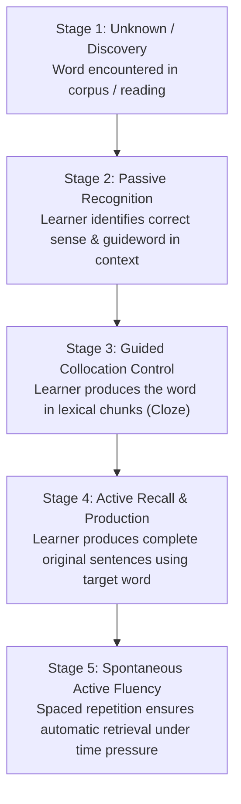

# LingoFlow Vocabulary Architecture & Blueprint

## 1. Sources & Data Inventory

LingoFlow builds upon a multi-tier lexical foundation uniting frequency corpora, the CEFR-graded English Vocabulary Profile (EVP), specialized academic/business registers, and relational synonym pairings.

### 1.1 Source Breakdown

1. **EVP (English Vocabulary Profile - Cambridge)**
   - **Coverage**: 15,696 sense-level records across CEFR levels **A1, A2, B1, B2, C1, and C2** (3,807 C2 entries).
   - **Key Attributes**: Base Word (lemma), Guideword (sense differentiator, e.g., `KEEP IN GOOD CONDITION`), CEFR Level, Part of Speech, 21 Semantic Topics, and direct English Profile detail URLs (`https://www.englishprofile.org/british-english/words/detail/...`).
   - **Strategic Role**: Defines the curriculum hierarchy and prevents generic definition collisions by anchoring every word to a distinct CEFR sense and guideword.

2. **NGSL (New General Service List - Browne, Culligan & Phillips 2013)**
   - **Coverage**: 2,800 high-frequency general English headwords.
   - **Key Attributes**: Dual learner-friendly definitions (NGSL Builder and NGSL 1.0 definitions).
   - **Strategic Role**: Forms the 90%+ reading comprehension core for everyday English.

3. **NGSL-Speaking-722 (Spoken English Frequency List)**
   - **Coverage**: 722 core oral lemmas with simplified definitions.
   - **Strategic Role**: Critical for **active spoken vocabulary**—identifies the highest-frequency words needed for conversational production.

4. **AWL & NAWL (Academic Word Lists)**
   - **AWL-570**: Coxhead's Academic Word List (570 word families).
   - **NAWL-960**: New Academic Word List (960 lemmas) with parts of speech and definitions.
   - **Strategic Role**: High-frequency academic register for research, IELTS, TOEFL, and formal writing.

5. **BSL-1700 (Business Service List)**
   - **Coverage**: 1,754 business and professional terms.
   - **Key Attributes**: Standard Frequency Index (`SFI`), Usage dispersion (`U`), Diversity (`D`), and Frequency counts (`F`).
   - **Strategic Role**: Corpus-backed prioritization for workplace, financial, and corporate communication.

6. **TOEIC-1200 (Test of English for International Communication)**
   - **Coverage**: 1,253 targeted workplace communication lemmas with practical definitions.

7. **Synonym Clusters & Contrast Pairings**
   - **Synonyms list**: 936 synonym clusters and paraphrase groups (e.g., *annual / yearly / per year*, *a rise / an increase / a growth*).
   - **Synonym-must learn**: 185 high-value distinction and nuance pairs (e.g., *anticipate / foreshadow*, *appearance / physiognomy*).
   - **Strategic Role**: Equips learners to paraphrase actively and upgrade passive low-register words into targeted CEFR/academic equivalents.

8. **Context & Bilingual Annotations**
   - **LEARN A1-C2**: 541 deeply enriched senses featuring usage definitions, collocations, example sentences, and Russian translation glosses.
   - **GSL-NGLS**: Direct Russian glosses for core vocabulary (*bowl $\rightarrow$ чаша*, *pitch $\rightarrow$ подача*).

9. **Lexical Corpus Totals & Benchmark Coverage**
   - **Total combined unique lemmas**: **11,139 words**.
   - **Corpus Coverage**:
     - GSL + AWL = **87%** text coverage
     - NGSL + NAWL = **92%** text coverage
     - NGSL + TOEIC = **99%** text coverage
     - NGSL + BSL = **97%** text coverage
   - **Semantic Topics (6,902 topic-tagged senses)**:
     - Communication (1,225), People: Personality (1,053), People: Actions (952), Describing Things (748), Body & Health (356), Food & Drink (253), Art & Media (242), Travel (231), Shopping (205), Work (201), Relationships (170), Homes & Buildings (170), Technology (161), Money (153), Animals (94), Education (92), Clothes (88), Crime (84), Politics (72), Natural World (261).

---

## 2. Data Collection & Normalization Pipeline

```
                 LingoFlow Raw Datasets (tmp/dset.xlsx)
                                   │
      ┌─────────────────┬──────────┴──────────┬─────────────────┐
      │                 │                     │                 │
     EVP               NGSL              Specialized         Synonyms
 (A1-C2 + C2)     (Core + Spoken)     (AWL/NAWL/BSL/TOEIC)  (Clusters + Nuance)
  senses/levels      frequency              registers           paraphrases
      │                 │                     │                 │
      └─────────────────┴──────────┬──────────┴─────────────────┘
                                   ↓
                       ETL / Normalization Engine
                                   ↓
                           PostgreSQL Database
                                   ↓
                   Prisma 7 Folder Schema (`prisma/schema/`)
```

---

## 3. The Vocabulary Store Model

A word is not a flat string with a definition. In natural language acquisition, vocabulary exists as a hierarchy:

```
Lexeme (base lemma, e.g. "maintain")
   │
   ├── Pronunciation (IPA UK / US, audio stream)
   │
   ├── Frequency Tags (NGSL rank, NAWL, BSL SFI, Spoken-722 flag)
   │
   ├── Sense #1 (CEFR: B1 | Guideword: "KEEP IN GOOD CONDITION")
   │     ├── Definition: "to make something continue in the same way or standard"
   │     ├── Russian gloss: "поддерживать в рабочем состоянии"
   │     ├── Collocations:
   │     │     ├── "maintain a system" (cloze: "[maintain] a system")
   │     │     ├── "maintain equipment"
   │     │     └── "maintain roads"
   │     └── Examples:
   │           └── "The company pays a regular fee to maintain the equipment."
   │
   ├── Sense #2 (CEFR: B2 | Guideword: "CONTINUE TO HAVE/DO")
   │     ├── Definition: "to express firmly your belief that something is true"
   │     ├── Collocations:
   │     │     ├── "maintain innocence"
   │     │     └── "maintain order"
   │     └── Examples:
   │           └── "He has always maintained that he was innocent."
   │
   └── Synonym Links (Links to SynonymCluster: "keep up", "sustain", "preserve")
```

---

## 4. Active Vocabulary Acquisition Methodology

### Why Traditional Systems Fail
Traditional vocabulary apps focus on **passive recognition** (showing a flashcard with a word and asking for a definition or translation). This produces learners who can recognize 5,000 words in a book but freeze when attempting to speak or write.

### The 5 Acquisition Stages



### Active Production Modalities in LingoFlow

1. **Sense Anchoring (No Ambiguity)**:
   - Learner is tested on the specific sense and guideword, eliminating confusion between polysemous words.
2. **Collocation Cloze Drills**:
   - Instead of asking for the definition of *decision*, prompt the chunk: `The committee must [...] a difficult decision.` $\rightarrow$ Tests grammatical and lexical compatibility.
3. **Paraphrase Upgrades**:
   - The user is presented with a basic sentence: *"The company saw a big rise in profits."*
   - Prompt: *"Upgrade using the C1 academic equivalent from your active deck:"* $\rightarrow$ *"The company experienced a substantial growth / expansion."*
4. **AI Generation & Evaluation Layer**:
   - Following the principle: **AI is a generation and evaluation layer, NOT the curriculum authority.**
   - The curriculum and ground truth remain grounded in EVP and NGSL. AI generates contextual situational prompts and evaluates learner-composed sentences for naturalness, grammar, and correct collocation usage.
5. **Adaptive Spaced Repetition (SRS)**:
   - Uses an SM-2 / FSRS scheduling engine tracking ease factor, repetition intervals, and failure history per sense.

---

## 5. Prisma 7 Multi-File Schema Architecture

The database schema is organized into modular files within `prisma/schema/`:

- **`base.prisma`**: Defines `generator client` (outputting to `../gen-client`), PostgreSQL datasource, and core enums (`CEFRLevel`, `VocabStatus`, `ListType`).
- **`user.prisma`**: User accounts and relationship ties to learning records.
- **`vocabulary.prisma`**: Core lexical models:
  - `Lexeme`: Base canonical lemma, phonetics, and audio references.
  - `FrequencyTag`: Corpus affiliations (NGSL, AWL, NAWL, BSL, TOEIC, Spoken-722) with rank, SFI, and dispersion metrics.
  - `Sense`: Distinct meaning, CEFR level, guideword, topic, English Profile URL, and definitions.
  - `Collocation`: Lexical chunks and cloze masks for active training.
  - `ExampleSentence`: Contextual usage sentences with optional audio and translations.
- **`synonyms.prisma`**:
  - `SynonymCluster`: Groups of related words and paraphrases.
  - `SynonymMember`: Mapping between clusters and specific senses or phrases.
- **`srs.prisma`**:
  - `UserVocabProgress`: Per-user learning state (`NEW` $\rightarrow$ `PASSIVE` $\rightarrow$ `ACTIVE_PRACTICE` $\rightarrow$ `MASTERED`), SRS interval, ease factor, due dates, cloze accuracy, and production metrics.
  - `SRSReviewLog`: Granular history of every review attempt, exercise type, and score.

---

## 6. Implementation Roadmap

1. **Schema Migration & Client Generation**:
   - Execute migrations using `prisma migrate dev` with Prisma 7 folder schema.
   - Generate type-safe Prisma Client to `prisma/gen-client`.
2. **ETL Seed Script (`scripts/seed-dataset.ts`)**:
   - Stream `tmp/dset.xlsx` sheets.
   - Upsert lexemes, senses, frequency tags, synonym clusters, and annotated examples.
3. **NestJS Modular Core**:
   - `VocabModule`: Lexeme/sense exploration, topic browsing, frequency filters.
   - `StudyModule`: Active study queues (daily due cards, new word introductions).
   - `SRSModule`: Spaced repetition calculations and interval scheduling.
   - `PracticeModule`: Cloze generation, sentence evaluation, and paraphrase exercises.
